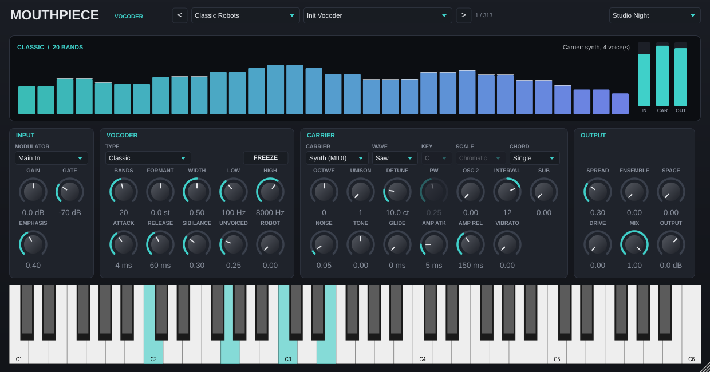

# Mouthpiece (working name)

A vocoder plugin (VST3 + standalone) with four vocoder engines, a built-in carrier synth, 313 factory
presets in 13 categories and four UI themes. Your voice (a microphone, a vocal track or any audio) is the
modulator; the carrier can be the built-in synth played from MIDI, a synth that follows your own pitch,
a drone chord, noise, or another track/plugin routed in on the sidechain. See `docs/FEATURES.md`.



Demo: `docs/demo-reel.mp3` (one spoken phrase through eight presets: Classic, Vintage, Choir, Talkbox,
Spectral, Auto Harmony without MIDI, Whisper, Monster).

## Build

```
cmake -B build -DCMAKE_BUILD_TYPE=Release            # fetches JUCE 8.0.4
# or: cmake -B build -DJUCE_DIR=/path/to/JUCE
cmake --build build --config Release
ctest --test-dir build                                # engine tests
```

macOS builds target macOS 11+ universal (Intel + Apple Silicon). No AVX2 or other `-march` flags are
used; the DSP is scalar C++. Windows builds use the static runtime.

Extras: `mouthpiece_render_demo voice.wav out.wav [preset names...]` renders a demo reel from any 16-bit
WAV. `-DMOUTHPIECE_BUILD_SCREENSHOT=ON` builds `mouthpiece_screenshot`, which writes a PNG of the editor
in every theme.

Layout: `Source/engine` is plain C++ (parameter table, carrier synth, pitch tracker, the four vocoder
cores, post effects, presets) with tests in `tests/`. `Source/plugin` is the JUCE wrapper and UI.

## Using it

**In a DAW (VST3).** Put Mouthpiece on the vocal or microphone track. It takes MIDI, so route a MIDI
track or keyboard to it to play the carrier synth (in Ableton Live: a MIDI track with "MIDI To" set to the
vocal track's Mouthpiece; in Reaper and Cubase: send MIDI to the plugin directly). No MIDI? Pick a preset
from **Auto Harmony** (the carrier follows the pitch you sing) or **Drones & Pads** (a held chord).

**Another plugin or track as the carrier.** Enable the plugin's sidechain input and route the synth,
guitar or pad track to it, then set Carrier to **External** (the **External Carrier** category). Set
Modulator Input to **Sidechain** to flip it: the voice arrives on the sidechain and the main input is the
carrier.

**Standalone with a microphone.** Open Options > Audio/MIDI Settings, pick your mic as the input, and
untick "Mute audio input" (JUCE mutes the input by default to avoid feedback; use headphones). Play the
on-screen keyboard, your computer keyboard or a MIDI controller.
